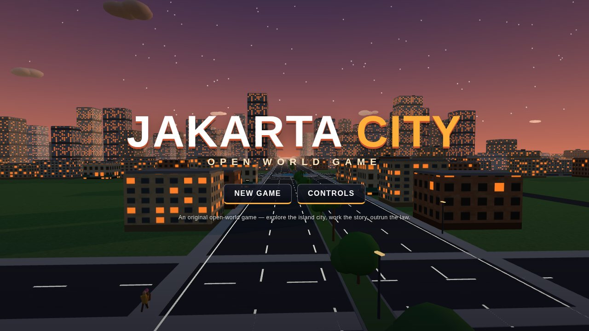

# Jakarta City

**An open-world crime game set in a fictionalised Jakarta** — a 1.6 × 2.3 km island city
of grand avenues, tower districts, kampung lanes, a container port, a stadium, a beach
resort and the Monas monument park, built with three.js and plain ES modules. No assets,
no network: every building texture, vehicle and sound is generated in code.



## The city

- **A living map** — three grand avenues, five arterials, a ring road, the Gatot Subroto
  diagonal through the Semanggi flyover, Menteng and Kebayoran grids, two dense kampungs,
  Ancol beach with a pier, a working port, GBK stadium and the Monas park.
- **Traffic with a brain** — cars, taxis, angkot minibuses, buses, trucks and helmeted
  bike riders follow a real road graph with left-hand lanes, queue behind each other,
  brake for pedestrians, and recover on their own when stuck. Every vehicle can be stolen.
- **People everywhere** — a hundred pedestrians walk the sidewalks between districts,
  sit on kampung stoops, beach towels and park benches, and run when trouble starts.
- **A full day** — the clock starts at noon; golden-hour light, drifting clouds, rain
  showers, then dusk: windows light up floor by floor, street lamps and headlights come
  on, the moon and stars come out.

## The game

- **Five story missions** with English NPC dialogue — *First Wheels*, *Special Delivery*,
  *The Passenger*, *Midnight Run* and *Heat Run* — plus endless **delivery** and **ojol**
  (motorbike taxi) side jobs that ring in on your phone.
- **Police that escalate** — a five-star wanted system: pursuit cars, officers who get
  out and shoot on foot, a five-star roadblock and a searchlight helicopter. You are only
  **BUSTED** if you are knocked down and caught; **WASTED** is when your health runs out.
- **Six weapons** — fists, machete, pistol, SMG, pump shotgun and rifle — with an armory
  that sells guns, ammo and body armor. A punch that hits nobody is not a crime.
- **Working places, all on 4-metre markers** — the **Bengkel** workshop's Pay N Spray
  (from the driver's seat), **POLSEK** surrender-and-fine, **RSUD** hospital treatment,
  a karaoke bar you can walk into, a kampung house interior, a house for sale that becomes
  your permanent save point, and drivable motorboats at the beach and the pier.
- **Saves and cheats** — autosave every 15 seconds, CONTINUE/LOAD from the menu, and the
  classic typed cheat codes (try `BANYAKDUIT`, `MOBIL`, `SENJATA`… and one secret code).
- **SA-style presentation** — money, clock, wanted stars, health/armor bars, weapon and
  radio ticker, a live minimap, a full world map (P), area-entry notifications, and a
  main menu that floats over the living city at golden hour.

## Controls

| Input | Action |
| --- | --- |
| W A S D / arrows | Move / drive |
| Mouse (click the game first) | Camera · left button fire · right button aim |
| Shift | Sprint |
| Space | Jump |
| F | Enter / exit car or boat |
| E | Talk · use · buy · answer phone |
| 1–6 / wheel | Weapons |
| J | Accept a side job |
| P or M | World map |
| H | Horn · C | Cheat panel |

Touch controls appear automatically on touch devices.

## Running it

```
node serve.ts        # then open http://localhost:8080
```

The game is the `game/` folder — static files, no build step. `main.ts` is the
competition program that packages `game/` and `screenshots/` into the judged dossier.
Screenshots are staged reproducibly through `shots.json` (`?shot=menu|bundaran|mission|night`).
